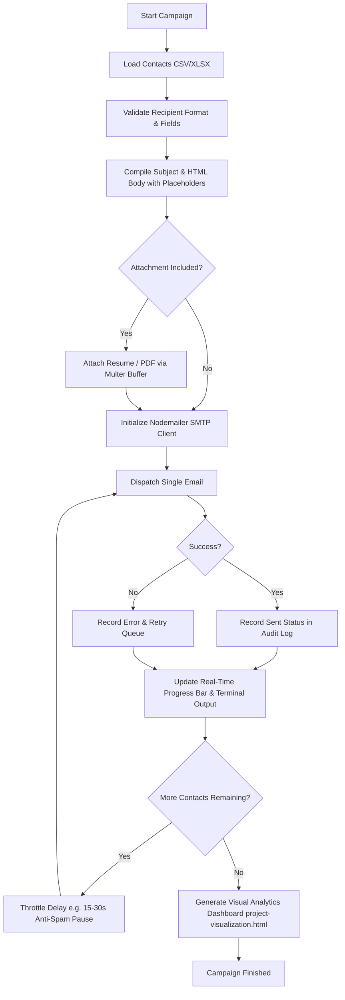

# 🌐 Cold Email & Placement Bot — Web Application & Dispatcher

[](https://nodejs.org/)
[](https://expressjs.com/)
[](https://nodemailer.com/)
[](LICENSE)

A full-stack, enterprise-grade cold email automation platform designed for candidates, recruiters, and sales teams. Features an intuitive multi-tab workspace, CSV/Excel contact ingestion, dynamic placeholder template engine, resume attachment support, throttled queue dispatching, and interactive visual analytics.

---

## 🏛️ System Architecture

```text
┌──────────────────────────────────────────────────────────────────────────────────┐
│                            FRONTEND WORKSPACE (SPA)                              │
│                                                                                  │
│   ┌──────────────────────────────────────────────────────────────────────────┐   │
│   │                 MULTI-TAB CLIENT INTERFACE (app.js)                      │   │
│   │                                                                          │   │
│   │  [Setup Tab]       [Contacts Tab]     [Template Tab]    [Attachment Tab] │   │
│   │  • SMTP Host/Port  • CSV/XLSX Parser  • WYSIWYG Editor  • Resumes (PDF)  │   │
│   │  • Auth Password   • Search & Filter  • Token Chips     • Portfolios     │   │
│   │  • Delay Throttler • Column Mapping   • Preview Engine  • Cover Letters  │   │
│   │                                                                          │   │
│   │  [Send Tab & Campaign Monitor]                                           │   │
│   │  • Batch Queue Controller   • Live Progress Bar  • Real-time Console Log │   │
│   └─────────────────────────────────────┬────────────────────────────────────┘   │
└─────────────────────────────────────────┼────────────────────────────────────────┘
                                          │ HTTP REST / Multipart Form Data
                                          ▼
┌──────────────────────────────────────────────────────────────────────────────────┐
│                         BACKEND DISPATCH SERVER (server.js)                      │
│                                                                                  │
│   ┌───────────────────────────┐            ┌─────────────────────────────────┐   │
│   │     EXPRESS ROUTING       │            │       ATTACHMENT ENGINE         │   │
│   │                           │            │           (Multer)              │   │
│   │ • POST /api/upload-contacts───────────►│ • Validates File Types (PDF)   │   │
│   │ • POST /api/upload-resume │            │ • Sanitizes Upload Filenames    │   │
│   │ • POST /api/send-batch    │            │ • Manages Temp Storage Buffer   │   │
│   │ • GET  /api/campaign-log  │            └────────────────┬────────────────┘   │
│   └─────────────┬─────────────┘                             │                    │
│                 │                                           │                    │
│                 ▼                                           │                    │
│   ┌───────────────────────────┐                             │                    │
│   │   BATCH DISPATCH QUEUE    │                             │                    │
│   │   (Pacing & Throttling)   │                             │                    │
│   │                           │                             │                    │
│   │ • Compiles Placeholders   │                             │                    │
│   │   ({{name}}, {{company}}) │                             │                    │
│   │ • Injects Attachments ◄───┼─────────────────────────────┘                    │
│   │ • Applies Randomized Delay│                                                  │
│   │ • Logs Outcome to Local   │                                                  │
│   │   JSON Audit Trail        │                                                  │
│   └─────────────┬─────────────┘                                                  │
│                 │                                                                │
│                 ▼                                                                │
│   ┌───────────────────────────┐                                                  │
│   │   NODEMAILER TRANSPORTER  │                                                  │
│   │   • TLS/SSL Secure Socket │                                                  │
│   │   • SMTP Authentication   │                                                  │
│   └─────────────┬─────────────┘                                                  │
└─────────────────┼────────────────────────────────────────────────────────────────┘
                  │ SMTP (Port 465 / 587)
                  ▼
┌──────────────────────────────────────────────────────────────────────────────────┐
│                   MAIL EXCHANGE (Gmail / Outlook / Custom SMTP)                  │
└──────────────────────────────────────────────────────────────────────────────────┘
```

### 📊 Component Workflow



---

## ✨ Features

- **Multi-Tab Dashboard**: Clean, responsive dark-mode interface covering Setup, Contacts, Templates, Attachments, and Sending.
- **Universal Contact Ingestion**: Upload `.csv` or `.xlsx` files with live tabular search, sorting, and field verification.
- **Dynamic Templating**: Personalized placeholders (`{{name}}`, `{{company}}`, `{{role}}`) seamlessly replaced per recipient.
- **Resume & Document Attachments**: Local PDF resume upload with automated attachment binding.
- **Anti-Spam Throttling**: Configurable delay pacing between successive dispatches to prevent IP or email reputation penalties.
- **Interactive Visual Analytics**: Standalone visual campaign report (`project-visualization.html`) showing delivery percentages and response telemetry.
- **Secure Credentials**: Supports Gmail App Passwords and custom SMTP servers without cloud data retention.

---

## 🛠️ Project Structure

```text
cold-email-web/
├── server.js                   # Express server and Nodemailer SMTP engine
├── index.html                  # Multi-tab responsive single page application
├── index.css                   # Custom dark-theme styling and micro-interactions
├── app.js                      # Client-side state, form validation, and REST calls
├── templates/                  # Pre-configured email templates (HTML & Text)
│   ├── default.html
│   └── default.txt
├── sample-data/                # Sample recruiter contact lists for testing
│   ├── sample_hr_list.csv
│   └── sample_hr_list.xlsx
├── project-visualization.html  # Interactive campaign analytics report
├── package.json                # Project dependencies and npm scripts
├── LICENSE                     # MIT License
└── README.md                   # Documentation
```

---

## 🚀 Quick Start

### 1. Prerequisites
- **Node.js** v18.0.0 or higher
- **npm** (bundled with Node.js)

### 2. Installation
```bash
git clone https://github.com/snowowl69/cold-email-web.git
cd cold-email-web
npm install
```

### 3. Start the Server
```bash
npm start
```
By default, the server boots at: **`http://localhost:3000`**

### 4. Gmail SMTP Configuration
1. Navigate to Google Account > **Security** > **2-Step Verification** > **App passwords**.
2. Create an App Password for "Mail".
3. Open `http://localhost:3000`, click the **Setup** tab, and enter your Gmail address and 16-character App Password.

---

## 📄 License

This project is licensed under the [MIT License](LICENSE) — Copyright (c) 2026 Raghav Goyal.
