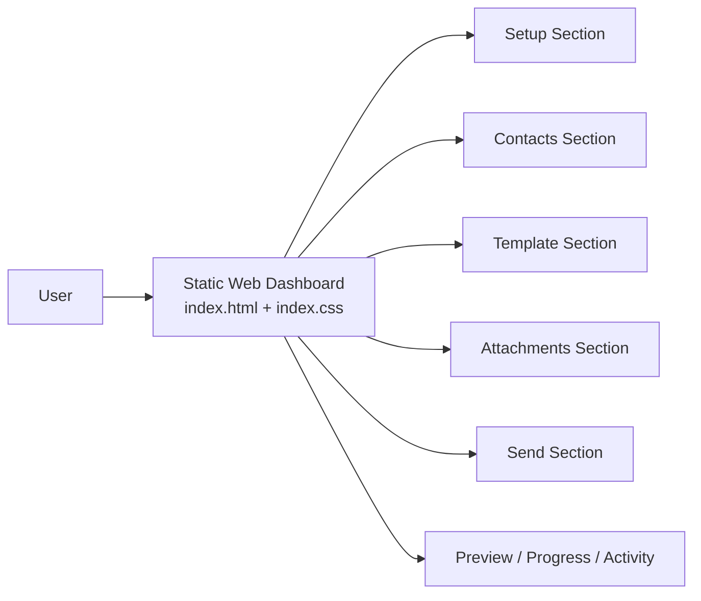
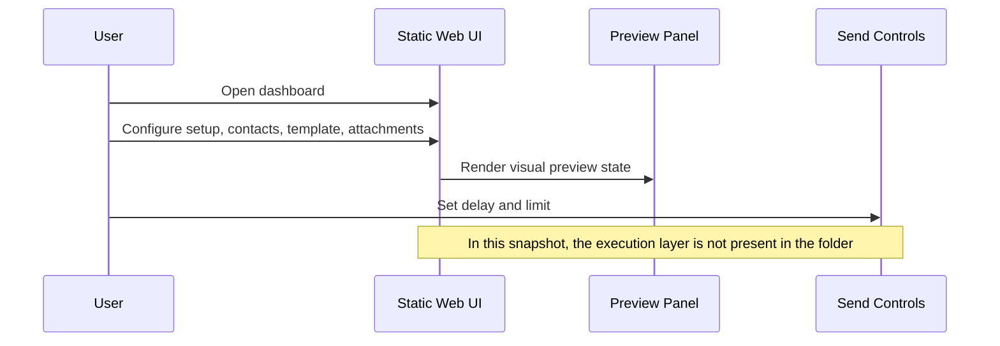

# Placement Email Bot - Web App Report

## Overview
This project is a premium static web interface for managing placement email campaigns. In the current workspace snapshot, it contains the dashboard markup and styling only, so the report reflects the present UI shell rather than a fully wired backend application.

## Architecture

## Main Sections
- Setup: Gmail address, app password, and sender name.
- Contacts: CSV/XLSX upload area and contact table.
- Template: subject editor, body editor, placeholder helpers, and live preview panel.
- Attachments: file drop zone plus CC/BCC controls.
- Send: delay slider, send limit, and progress/status area.

## Workflow
1. The user opens the dashboard and configures the sender identity.
2. Contacts are imported through the upload zone and displayed in a table.
3. The user writes a subject and body using placeholders such as `{name}` and `{company}`.
4. Attachments and CC/BCC recipients are prepared.
5. The send section is used to define pacing and campaign limits.
6. Activity and progress panels are intended to show campaign state during execution.

## How The System Works At Runtime
- The current snapshot is a visual and interaction-ready shell, not a complete runtime application with visible JavaScript behavior in this folder.
- The HTML provides the structure for tabs, forms, preview cards, and controls.
- The CSS provides the complete visual language: dark graphite surfaces, glass cards, gradients, and responsive spacing.
- Because there is no `app.js` or backend file present here, the actual sending logic is not implemented in the current workspace snapshot.
- This means the web app currently acts as the campaign workspace design layer, while the Chrome extension and CLI provide the real execution paths.

## UI Flow

## Operational Notes
- The page is designed as a premium dashboard with tabbed navigation and card-based sections.
- Fonts are loaded from Google Fonts and the styling uses a dark, high-contrast visual system.
- The layout is responsive and intended to support both desktop and smaller screens.
- To become an executable app, this folder would still need the missing JavaScript controller or a backend integration.

## Summary
The web app is the presentation layer of the placement outreach system. It currently defines the campaign workspace and visual controls, while the actual send execution is handled by the browser extension and CLI projects.